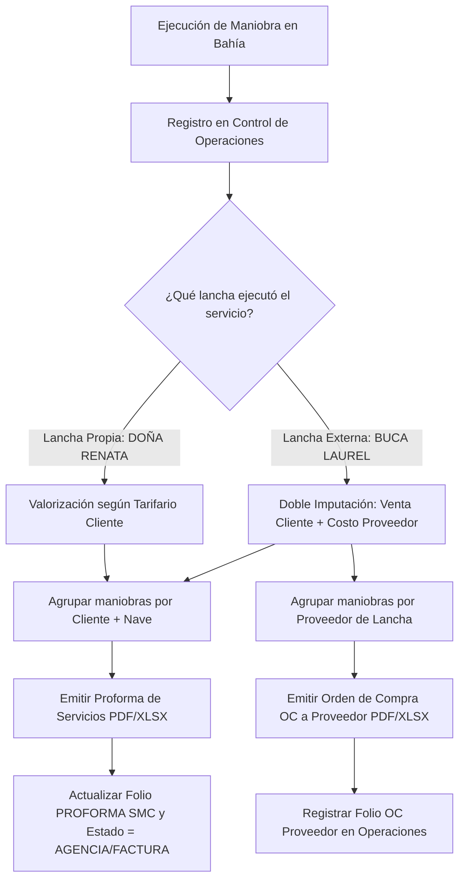
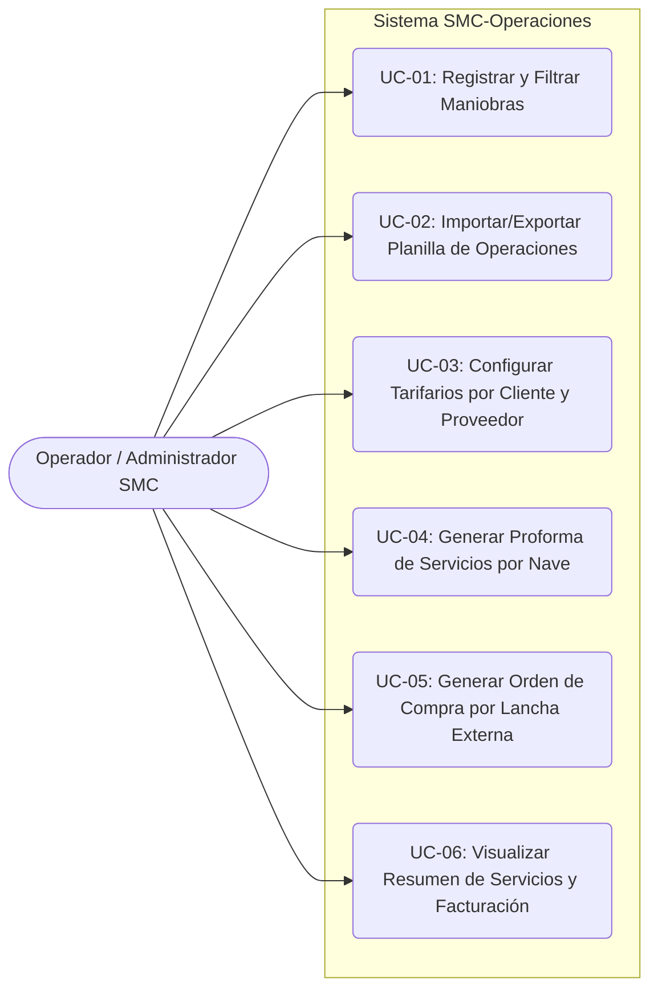
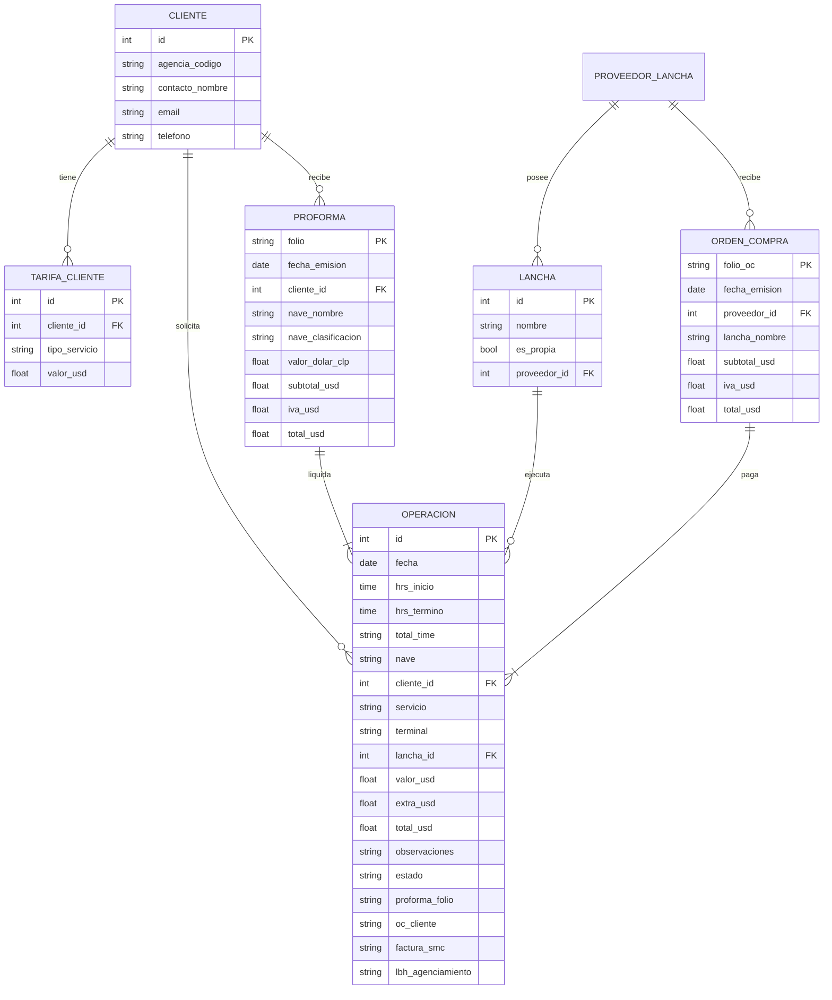
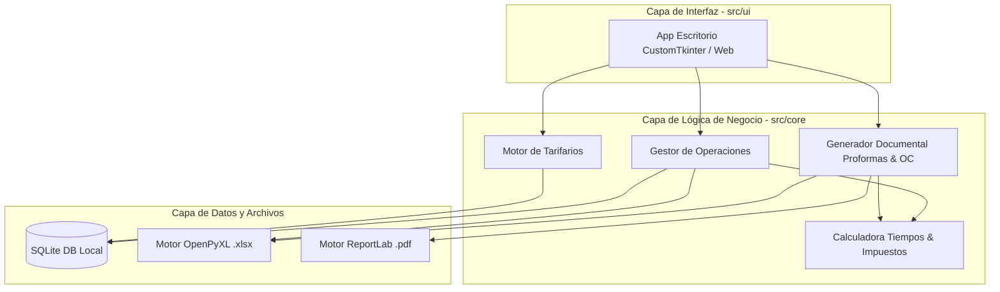

# Especificación de Requisitos de Software (SRS)
**Proyecto:** Sistema de Control de Operaciones, Proformas de Servicio y Órdenes de Compra (SMC-Operaciones)  
**Organización:** Servicios Marítimos Carrere (SMC)  
**Responsable:** Jorge Eduardo Álvarez Alarcón  
**Fecha de Entrega MVP:** 27 de noviembre de 2026  

---

## 1. Alcance y Objetivos

### 1.1 Alcance del Sistema
El sistema comprende un módulo de gestión operativa y liquidación comercial marítima para **Servicios Marítimos Carrere (SMC)**. Aborda desde el registro de maniobras portuarias en muelle/bahía (Control de Operaciones), la valorización automática mediante tarifarios diferenciados por cliente, hasta la emisión documental en formato Excel (`.xlsx`) y PDF (`.pdf`) de:
1. **Proformas de Servicio (Orden de Servicio / Pre-factura):** Liquidación comercial enviada al cliente (agencia naviera) por los servicios prestados a una nave específica.
2. **Órdenes de Compra (OC Proveedores):** Documento de liquidación de pago emitido por SMC hacia proveedores externos de lanchas cuando una maniobra es ejecutada por una embarcación subcontratada o arrendada (ej. lancha `BUCA LAUREL`).

### 1.2 Objetivos
- **Objetivo General:** Automatizar el flujo de control de operaciones marítimas y la emisión de Proformas de Servicio y Órdenes de Compra de SMC, eliminando errores de transcripción manual y asegurando trazabilidad financiera.
- **Objetivos Específicos:**
  1. Centralizar el registro de operaciones validando horas de inicio y término, calculando automáticamente la duración (`TOTAL TIME`) y el monto total en USD (`VALOR USD + EXTRA USD`).
  2. Implementar un catálogo configurable de tarifarios únicos por cliente y por proveedor de lancha externa.
  3. Generar Proformas de Servicio agrupadas por Cliente y Nave en menos de 5 segundos, con desglose de Subtotal USD, IVA ($19\%$), Total USD y referencia de Tipo de Cambio (Dólar Observado).
  4. Generar Órdenes de Compra para liquidar servicios ejecutados por lanchas arrendadas a terceros.
  5. Entregar un producto modular (código fuente desacoplado + ejecutable portable) integrable al ecosistema de software de la empresa.

---

## 2. Información del Dominio del Problema

### 2.1 Contexto Operativo
Servicios Marítimos Carrere (SMC) presta servicios de apoyo marítimo y lanchaje portuario (recepción de autoridades, embarque/desembarque de tripulación o *Régimen Up/Out*, provisión de vituallas o *Shipchandler*, amarra y desamarra de naves, relevo de conectores, entre otros) a diversas agencias navieras (`LBH`, `CPT BOATS`, `IAN TAYLOR`, `BUCALEMU`, `LORENA IQQ`) en terminales portuarios como `GIRA`, `SITIO 1`, `SITIO 2`, `SITIO 3`, `SITIO 4`, `COMAP`, `ESMAX` y `COPEC`.

### 2.2 Modalidades de Operación de Lanchas
1. **Operación con Flota Propia (`DOÑA RENATA`):** SMC ejecuta la maniobra con su embarcación propia. Genera un derecho de cobro al cliente mediante una **Proforma de Servicios**.
2. **Operación con Flota Subcontratada / Arrendada (`BUCA LAUREL` u otras):** Cuando SMC requiere apoyo de un proveedor externo de lanchas, dicho proveedor ejecuta la maniobra para el cliente de SMC. Esta operación tiene doble efecto comercial:
   - **Venta (Proforma de Servicio):** SMC le cobra el servicio a la agencia naviera cliente según su tarifario comercial.
   - **Costo (Orden de Compra - OC):** SMC emite una Orden de Compra a favor del proveedor dueño de la lancha externa para pagarle el arriendo o servicio prestado.

### 2.3 Glosario del Dominio
| Término | Definición en el Dominio SMC |
| :--- | :--- |
| **Nave** | Buque mercante o pesquero atendido (ej. *SHUN XING 17*, *HONG RUN 108*, *RONG HENG 68*). |
| **Cliente / Agencia** | Agencia marítima que solicita el servicio para la nave (ej. *LBH*, *CPT BOATS*). |
| **Lancha** | Embarcación menor que realiza la maniobra en bahía (*DOÑA RENATA* = propia; *BUCA LAUREL* = externa). |
| **TT (Total Time)** | Duración efectiva de la maniobra ($\text{HRS TERMINO} - \text{HRS INICIO}$). |
| **Proforma de Servicio (PDS)** | Pre-factura comercial emitida al cliente con el detalle de maniobras realizadas a una nave (`SMC-PDS-IQQ-...`). |
| **Orden de Compra (OC SMC)** | Documento emitido por SMC para pagar a un proveedor externo de lanchas. |
| **OC CTE** | Número de Orden de Compra emitida por el Cliente hacia SMC para autorizar la facturación. |

---

## 3. Necesidades de Negocio y Reglas de Negocio (RN)

- **RN-01 (Cálculo de Duración):** `TOTAL TIME` se calcula como $\text{HRS TERMINO} - \text{HRS INICIO}$. Si $\text{HRS TERMINO} < \text{HRS INICIO}$ (maniobra nocturna que cruza las 00:00 hrs), el sistema debe sumar 24 horas al término automáticamente.
- **RN-02 (Tarifario Único por Cliente):** Cada combinación $(\text{CLIENTE}, \text{SERVICIO})$ tiene un precio base sugerido en USD, el cual puede ser ajustado manualmente o complementado con un monto `EXTRA USD` (por recargo horario o sobretiempo) y descuento (`Dcto`).
- **RN-03 (Cálculo de Totales de Proforma):**
  $$\text{Total Línea} = (\text{Cantidad} \times \text{Precio Unitario USD}) + \text{Extra USD} - \text{Descuento USD}$$
  $$\text{Subtotal USD} = \sum \text{Total Línea}$$
  $$\text{IVA USD} = \text{Subtotal USD} \times 0.19$$
  $$\text{Total Proforma USD} = \text{Subtotal USD} + \text{IVA USD} + \text{Otros}$$
- **RN-04 (Detección de Orden de Compra a Proveedor):** Toda operación cuya `LANCHA` esté catalogada como `EXTERNA` (ej. `BUCA LAUREL`) debe quedar disponible en la bandeja de "Pendientes de Orden de Compra a Proveedor".
- **RN-05 (Prevención de Doble Cobro):** Cuando un conjunto de operaciones se incluye en una Proforma emitida, el campo `PROFORMA SMC` de cada operación se actualiza automáticamente con el folio generado (ej. `SMC-PDS-IQQ-LBH-V6526`) y su `ESTADO` cambia a `AGENCIA` o `FACTURA`.

---

## 4. Requerimientos del Sistema

### 4.1 Requerimientos Funcionales (RF)
- **RF-01 (Importación de Planilla Base):** El sistema debe permitir importar registros históricos desde el archivo `Control de Operaciones Iquique.xlsx` manteniendo las 18 columnas estándar.
- **RF-02 (Gestión de Operaciones - CRUD):** Permitir registrar, editar, listar y filtrar operaciones por Fecha, Nave, Cliente, Servicio, Terminal, Lancha y Estado (`PENDIENTE`, `AGENCIA`, `FACTURA`, `INTERNO`).
- **RF-03 (Gestión de Tarifarios y Clientes):** Administrar los datos maestros de Clientes (Contacto, Agencia, Email, Teléfono) y su matriz de precios en USD por tipo de servicio.
- **RF-04 (Generación de Proforma de Servicios):** Permitir seleccionar un Cliente, una Nave y un conjunto de operaciones registradas para generar automáticamente la Proforma de Servicios con su encabezado comercial, tabla de maniobras (formato `DD/MM/YYYY HH:MM:SS a HH:MM:SS TT: H:MM:SS`), Valor Dólar del día, Subtotal, IVA ($19\%$) y Total USD.
- **RF-05 (Generación de Orden de Compra a Proveedor de Lancha):** Permitir seleccionar operaciones realizadas por lanchas externas (ej. `BUCA LAUREL`) en un rango de fechas para emitir la Orden de Compra con el detalle de maniobras y tarifas de costo acordadas con el proveedor.
- **RF-06 (Exportación Documental Dual):** Exportar tanto las Proformas de Servicio como las Órdenes de Compra en formato `.xlsx` (editable con fórmulas vivas) y `.pdf` (formato corporativo SMC listo para envío al cliente o proveedor).
- **RF-07 (Panel de Resumen / Estadísticas):** Mostrar el resumen de maniobras por Cliente y Tipo de Servicio (equivalente automatizado de la hoja `GRAFICO X SERVICIOS`) y montos acumulados en USD.

### 4.2 Requerimientos No Funcionales (RNF)
- **RNF-01 (Portabilidad Multiplataforma):** El código debe ejecutarse sin modificaciones en Linux Mint (entorno de desarrollo) y Windows 10/11 (entorno de operación de SMC).
- **RNF-02 (Modularidad e Integrabilidad):** La lógica de negocio (`src/core`) debe estar desacoplada de la interfaz gráfica (`src/ui`) para permitir su futura incorporación en el ERP o aplicación central de la empresa.
- **RNF-03 (Persistencia Local sin Dependencias Externas):** Uso de SQLite embebido con sincronización directa a archivos Excel (`.xlsx`), sin requerir servidores de base de datos dedicados para el MVP.
- **RNF-04 (Rendimiento):** La generación de un archivo PDF o Excel de Proforma u Orden de Compra no debe superar los 3 segundos.

---

## 5. Procesos y Diagramas del Sistema

### 5.1 Diagrama de Proceso de Negocio (Flujo Operativo y Comercial)

### 5.2 Diagrama de Casos de Uso

### 5.3 Modelo de Datos (Diagrama Entidad-Relación)

### 5.4 Arquitectura de Componentes

---

## 6. Especificación Detallada de Casos de Uso Principales

### UC-04: Generar Proforma de Servicios por Nave
- **Actor:** Administrador Comercial / Operador SMC.
- **Precondiciones:** Existen operaciones registradas para un Cliente y una Nave sin proforma asignada (o seleccionadas explícitamente).
- **Flujo Principal:**
  1. El usuario selecciona el cliente (ej. `LBH`), la nave (ej. `SHUN XING 17`) y el rango de fechas (ej. `29/10/2026`).
  2. El sistema lista las operaciones coincidentes mostrando Fecha, Horario, `TT`, Servicio y Valor USD.
  3. El usuario ingresa el Folio de Proforma (ej. `SMC-PDS-IQQ-LBH-V6526`), la fecha de emisión y el Valor Dólar Observado (ej. `$981,08`).
  4. El sistema calcula Subtotal (`2.030,00 USD`), IVA $19\%$ (`385,70 USD`) y Total (`2.415,70 USD` / `$2.416 USD`).
  5. El sistema genera el archivo `.xlsx` y `.pdf` con el formato oficial de SMC y asocia el folio a las operaciones en la base de datos.

### UC-05: Generar Orden de Compra (OC) por Lancha Arrendada
- **Actor:** Administrador Comercial / Operador SMC.
- **Precondiciones:** Existen operaciones cuya columna `LANCHA` corresponde a un proveedor externo (ej. `BUCA LAUREL`).
- **Flujo Principal:**
  1. El usuario abre el módulo "Órdenes de Compra Proveedores" y filtra por Lancha (`BUCA LAUREL`) y fechas (ej. `21/10/2026`).
  2. El sistema carga las maniobras realizadas (ej. 6 maniobras de `REGIMEN UP` y `REGIMEN OUT` para las naves `RONG HENG 68` y `HUA YING 66`).
  3. El usuario verifica o ajusta la tarifa de costo pactada con el proveedor de la lancha y asigna el número de OC (`SMC-OC-IQQ-...`).
  4. El sistema genera la Orden de Compra en `.xlsx` y `.pdf` lista para enviar al proveedor y marca las maniobras como liquidadas en compras.