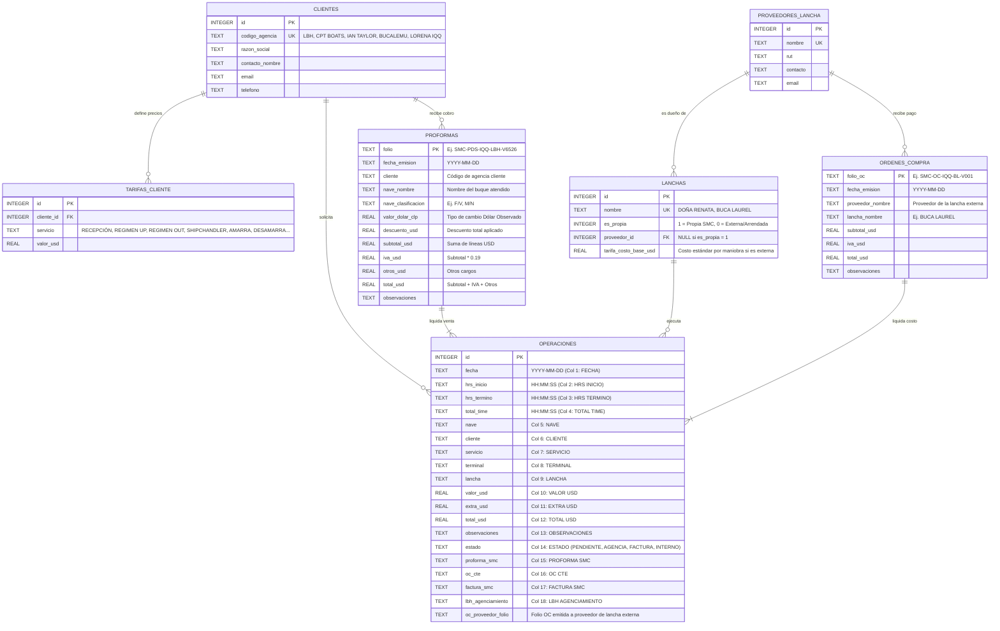

# Phase 1: Data Model & SQLite Schema Design

**Feature**: `001-operaciones-proformas-oc`
**Date**: 2026-11-13
**Database Engine**: SQLite 3 (`data/smc_operaciones.db` en producción, `:memory:` o `tmp_path` en `pytest`)

---

## 1. Diagrama Entidad-Relación (ERD)



---

## 2. Esquema DDL SQLite (`src/core/database.py`)

```sql
PRAGMA foreign_keys = ON;

CREATE TABLE IF NOT EXISTS clientes (
    id INTEGER PRIMARY KEY AUTOINCREMENT,
    codigo_agencia TEXT NOT NULL UNIQUE,
    razon_social TEXT NOT NULL,
    contacto_nombre TEXT DEFAULT '',
    email TEXT DEFAULT '',
    telefono TEXT DEFAULT ''
);

CREATE TABLE IF NOT EXISTS tarifas_cliente (
    id INTEGER PRIMARY KEY AUTOINCREMENT,
    cliente_id INTEGER NOT NULL,
    servicio TEXT NOT NULL,
    valor_usd REAL NOT NULL CHECK (valor_usd >= 0),
    UNIQUE(cliente_id, servicio),
    FOREIGN KEY (cliente_id) REFERENCES clientes(id) ON DELETE CASCADE
);

CREATE TABLE IF NOT EXISTS proveedores_lancha (
    id INTEGER PRIMARY KEY AUTOINCREMENT,
    nombre TEXT NOT NULL UNIQUE,
    rut TEXT DEFAULT '',
    contacto TEXT DEFAULT '',
    email TEXT DEFAULT ''
);

CREATE TABLE IF NOT EXISTS lanchas (
    id INTEGER PRIMARY KEY AUTOINCREMENT,
    nombre TEXT NOT NULL UNIQUE,
    es_propia INTEGER NOT NULL CHECK (es_propia IN (0, 1)),
    proveedor_id INTEGER,
    tarifa_costo_base_usd REAL DEFAULT 0.0,
    FOREIGN KEY (proveedor_id) REFERENCES proveedores_lancha(id) ON DELETE SET NULL
);

CREATE TABLE IF NOT EXISTS operaciones (
    id INTEGER PRIMARY KEY AUTOINCREMENT,
    fecha TEXT NOT NULL,
    hrs_inicio TEXT NOT NULL,
    hrs_termino TEXT NOT NULL,
    total_time TEXT NOT NULL,
    nave TEXT NOT NULL,
    cliente TEXT NOT NULL,
    servicio TEXT NOT NULL,
    terminal TEXT DEFAULT '',
    lancha TEXT NOT NULL,
    valor_usd REAL NOT NULL DEFAULT 0.0,
    extra_usd REAL NOT NULL DEFAULT 0.0,
    total_usd REAL NOT NULL DEFAULT 0.0,
    observaciones TEXT DEFAULT '',
    estado TEXT NOT NULL DEFAULT 'PENDIENTE',
    proforma_smc TEXT DEFAULT '',
    oc_cte TEXT DEFAULT '',
    factura_smc TEXT DEFAULT '',
    lbh_agenciamiento TEXT DEFAULT '',
    oc_proveedor_folio TEXT DEFAULT ''
);

CREATE INDEX IF NOT EXISTS idx_operaciones_fecha ON operaciones(fecha);
CREATE INDEX IF NOT EXISTS idx_operaciones_cliente_nave ON operaciones(cliente, nave);
CREATE INDEX IF NOT EXISTS idx_operaciones_lancha ON operaciones(lancha);
CREATE INDEX IF NOT EXISTS idx_operaciones_estado ON operaciones(estado);
CREATE INDEX IF NOT EXISTS idx_operaciones_proforma ON operaciones(proforma_smc);

CREATE TABLE IF NOT EXISTS proformas (
    folio TEXT PRIMARY KEY,
    fecha_emision TEXT NOT NULL,
    cliente TEXT NOT NULL,
    nave_nombre TEXT NOT NULL,
    nave_clasificacion TEXT DEFAULT 'M/N',
    valor_dolar_clp REAL NOT NULL DEFAULT 980.0,
    descuento_usd REAL NOT NULL DEFAULT 0.0,
    subtotal_usd REAL NOT NULL,
    iva_usd REAL NOT NULL,
    otros_usd REAL NOT NULL DEFAULT 0.0,
    total_usd REAL NOT NULL,
    observaciones TEXT DEFAULT ''
);

CREATE TABLE IF NOT EXISTS ordenes_compra (
    folio_oc TEXT PRIMARY KEY,
    fecha_emision TEXT NOT NULL,
    proveedor_nombre TEXT NOT NULL,
    lancha_nombre TEXT NOT NULL,
    subtotal_usd REAL NOT NULL,
    iva_usd REAL NOT NULL,
    total_usd REAL NOT NULL,
    observaciones TEXT DEFAULT ''
);
```

---

## 3. Reglas de Validación y Transiciones de Estado

### 3.1 Validaciones de Entidad (`src/core/models.py`)
1. **Horarios (`hrs_inicio`, `hrs_termino`)**: Formato `HH:MM:SS` (o `HH:MM` normalizado automáticamente a `HH:MM:00`).
2. **Duración (`total_time`)**: Calculada siempre por `calculator.calculate_total_time(hrs_inicio, hrs_termino)`. Nunca negativa.
3. **Montos de Operación**:
   - `valor_usd >= 0.0`
   - `extra_usd`: Permite valores $\ge 0.0$ para recargos horarios/sobretiempo (o descuentos puntuales si son negativos, siempre que `total_usd >= 0.0`).
   - `total_usd = round(valor_usd + extra_usd, 2)`.
4. **Cálculo de Proforma y Orden de Compra**:
   - `subtotal_usd = round(sum(op.total_usd for op in operaciones) - descuento_usd, 2)`
   - `iva_usd = round(subtotal_usd * 0.19, 2)`
   - `total_usd = round(subtotal_usd + iva_usd + otros_usd, 2)`

### 3.2 Transiciones de Estado de una Operación
- **`PENDIENTE`**: Estado inicial al registrar una maniobra nueva sin liquidar.
- **`AGENCIA`**: Estado asignado automáticamente cuando la maniobra se incluye en una **Proforma de Servicios** emitida al cliente (asignando `proforma_smc = <folio>`).
- **`FACTURA`**: Estado cuando la Proforma cuenta con Orden de Compra del cliente (`oc_cte`) y Factura emitida (`factura_smc`).
- **`INTERNO`**: Maniobra de apoyo interno de SMC no facturable a terceros.
- **Liquidación de Compra (`oc_proveedor_folio`)**: Independiente del estado de venta al cliente; cuando una maniobra realizada con lancha externa (`BUCA LAUREL`) se incluye en una **Orden de Compra**, su campo `oc_proveedor_folio` registra el folio de la OC para impedir dobles pagos al proveedor.

---

## 4. Datos de Precarga Inicial (Seed Data Real de SMC)

Al inicializar la base de datos (`seed_initial_data`), se precargan de manera idempotente los siguientes catálogos extraídos de la operación real de SMC en Iquique:

### 4.1 Catálogo de Clientes (`clientes`)
| `codigo_agencia` | `razon_social` | `contacto_nombre` | `email` | `telefono` |
| :--- | :--- | :--- | :--- | :--- |
| `LBH` | LBH Chile Ltda. | Edgardo Mendoza | `edgardo.mendoza@lbhchile.com` | `[+56] 9 4138 8805` |
| `CPT BOATS` | CPT Empresas Marítimas S.A. | Operaciones CPT Iquique | `operaciones.iqq@cpt.cl` | `[+56] 57 241 0000` |
| `IAN TAYLOR` | Empresas Taylor (Ian Taylor) | Agencia Iquique | `agency.iqq@iantaylor.com` | `[+56] 57 242 1500` |
| `BUCALEMU` | Servicios Marítimos Bucalemu | Operaciones Bucalemu | `operaciones@bucalemu.cl` | `[+56] 9 9000 1111` |
| `LORENA IQQ` | Agencia Marítima Lorena IQQ | Contacto Operaciones | `contacto@lorenaiqq.cl` | `[+56] 9 8000 2222` |

### 4.2 Catálogo de Proveedores y Lanchas (`proveedores_lancha` y `lanchas`)
| Lancha (`nombre`) | `es_propia` | Proveedor Asociado | `tarifa_costo_base_usd` | Rol en el Sistema |
| :--- | :---: | :--- | :---: | :--- |
| `DOÑA RENATA` | `1` (Sí) | *Flota Propia SMC* (`NULL`) | `0.00` | Genera Proforma de Venta al cliente |
| `BUCA LAUREL` | `0` (No) | *Servicios Marítimos Bucalemu / Armador Externo* | `200.00` | Genera Proforma de Venta al cliente **y** Orden de Compra (OC) al proveedor |

### 4.3 Matriz de Tarifarios Reales por Cliente (`tarifas_cliente`)
Extraída directamente de `Control de Operaciones Iquique.xlsx` y `docs/PLAN_DE_PRUEBAS.md`:

| Cliente (`codigo_agencia`) | Tipo de Servicio (`servicio`) | Valor Base Sugerido (`valor_usd`) |
| :--- | :--- | :---: |
| **`LBH`** | `RECEPCIÓN` | `650.00` |
| **`LBH`** | `REGIMEN UP` | `350.00` |
| **`LBH`** | `REGIMEN OUT` | `350.00` |
| **`LBH`** | `SHIPCHANDLER` | `330.00` |
| **`LBH`** | `AMARRA` | `460.00` |
| **`LBH`** | `DESAMARRA` | `460.00` |
| **`LBH`** | `MANIOBRA ABORTADA` | `300.00` |
| **`CPT BOATS`** | `RECEPCIÓN` | `350.00` |
| **`CPT BOATS`** | `DESPACHO` | `350.00` |
| **`CPT BOATS`** | `REGIMEN UP` | `200.00` |
| **`CPT BOATS`** | `REGIMEN OUT` | `200.00` |
| **`CPT BOATS`** | `SHIPCHANDLER` | `200.00` |
| **`CPT BOATS`** | `AMARRA` | `400.00` |
| **`CPT BOATS`** | `DESAMARRA` | `400.00` |
| **`CPT BOATS`** | `MANIOBRA ABORTADA` | `300.00` |
| **`CPT BOATS`** | `RELEVO CONECTORES` | `200.00` |
| **`CPT BOATS`** | `RELEVO L/M` | `200.00` |
| **`IAN TAYLOR`** | `RECEPCIÓN` | `500.00` |
| **`IAN TAYLOR`** | `REGIMEN UP` | `250.00` |
| **`IAN TAYLOR`** | `REGIMEN OUT` | `250.00` |
| **`IAN TAYLOR`** | `SHIPCHANDLER` | `180.00` |
| **`IAN TAYLOR`** | `AMARRA` | `455.00` |
| **`IAN TAYLOR`** | `DESAMARRA` | `455.00` |
| **`BUCALEMU`** | `EMBARQUE DE ITO VETTING` | `220.00` |
| **`LORENA IQQ`** | `SHIPCHANDLER` | `300.00` |

### 4.4 Catálogo de Terminales Portuarios de Iquique
Lista predeterminada en UI: `GIRA`, `SITIO 1`, `SITIO 2`, `SITIO 3`, `SITIO 4`, `COMAP`, `ESMAX`, `COPEC`.

