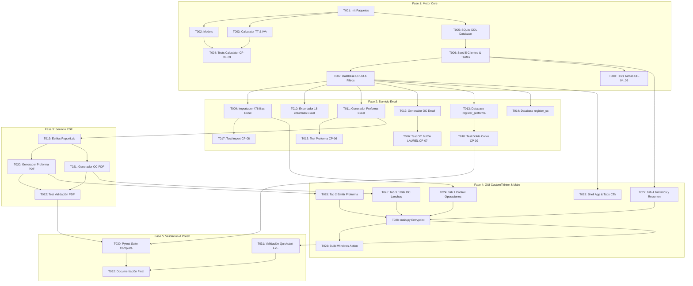

# Tasks: SMC Operaciones — Control de Operaciones, Proformas de Servicio y Órdenes de Compra

**Input**: Design documents from `/specs/001-operaciones-proformas-oc/` (`spec.md`, `plan.md`, `research.md`, `data-model.md`, `contracts/core-services.md`, `quickstart.md`)  
**Prerequisites**: Python 3.11+ virtual environment (`.venv`), `openpyxl`, `reportlab`, `customtkinter`, `pytest`  
**Tests**: TDD estricto con `pytest` validando los casos **CP-01** a **CP-09** de `docs/PLAN_DE_PRUEBAS.md`  
**Organization**: Tareas secuenciales organizadas en 4 fases principales más Setup y Polish final, con trazabilidad a historias de usuario (`[US1]`, `[US2]`, `[US3]`, `[US4]`).

---

## Phase 1: Setup & Motor Core (`src/core/`) — Foundational & Pruebas Unitarias (CP-01 a CP-05)

**Purpose**: Inicialización del proyecto, modelos de dominio, motor de cálculo con cruce de medianoche, esquema SQLite con precarga de tarifarios reales y pruebas unitarias aisladas.

- [ ] T001 Inicializar paquetes del proyecto y exportaciones base en `src/__init__.py`, `src/core/__init__.py`, `src/ui/__init__.py` y `tests/__init__.py`
- [ ] T002 [P] Implementar modelos de datos y excepciones de negocio (`Operacion` con 18 columnas estándar, `Cliente`, `TarifaCliente`, `Lancha`, `ProformaSummary`, `OrdenCompraSummary`, `DuplicateProformaError`) en `src/core/models.py`
- [ ] T003 [P] Implementar funciones puras de cálculo de duración (`calculate_total_time` con soporte de cruce de medianoche $+24\text{h}$), recargos (`calculate_operation_total_usd`), totales de Proforma (`calculate_proforma_totals` con IVA $19\%$) y glosa oficial en `src/core/calculator.py`
- [ ] T004 [P] Implementar suite de pruebas unitarias en `tests/test_calculator.py` validando CP-01 (duración diurna), CP-02 (cruce de medianoche sin tiempos negativos), CP-03 (recargo EXTRA USD) y fórmulas de IVA (19%) y totales en USD
- [ ] T005 Implementar inicialización de base de datos SQLite con claves foráneas, índices (`fecha`, `cliente`, `nave`, `lancha`, `estado`) y DDL de tablas (`clientes`, `tarifas_cliente`, `proveedores_lancha`, `lanchas`, `operaciones`, `proformas`, `ordenes_compra`) en `src/core/database.py`
- [ ] T006 Implementar semilla idempotente (`seed_initial_data`) en `src/core/database.py` precargando los 5 clientes reales (`LBH`, `CPT BOATS`, `IAN TAYLOR`, `BUCALEMU`, `LORENA IQQ`), sus 25 tarifas en USD y las lanchas `DOÑA RENATA` (propia) y `BUCA LAUREL` (externa con costo base $200.00 USD)
- [ ] T007 Implementar operaciones CRUD, filtros combinados (`fecha`, `nave`, `cliente`, `lancha`, `estado`) y consultas de inserción masiva en `src/core/database.py`
- [ ] T008 Implementar pruebas unitarias en `tests/test_calculator.py` validando CP-04 (autocompletado tarifa LBH Recepción $650 USD) y CP-05 (tarifa CPT BOATS Recepción $350 USD) contra el catálogo de tarifas

**Checkpoint**: Motor core (`models.py`, `calculator.py`, `database.py`) y pruebas unitarias CP-01 a CP-05 operativas y aprobadas al 100% con `pytest -v`.

---

## Phase 2: Servicio de Excel (`src/core/excel_service.py`) y Pruebas de Integración (CP-06 a CP-09)

**Purpose**: Importación íntegra de `Control de Operaciones Iquique.xlsx`, generación de Proformas y Órdenes de Compra en `.xlsx` con fórmulas vivas, y validación de integración contra casos reales.

- [ ] T009 [US1] Implementar importador `import_operations_from_excel` en `src/core/excel_service.py` procesando la hoja `CONTROL OPES`, mapeando las 18 columnas estándar e ignorando filas vacías con fórmulas en cero al final de la planilla
- [ ] T010 [P] [US1] Implementar exportador `export_operations_to_excel` en `src/core/excel_service.py` para generar libros `.xlsx` con el membrete oficial y las 18 columnas estándar
- [ ] T011 [US2] Implementar generador de Proforma en Excel `generate_proforma_excel` en `src/core/excel_service.py` replicando el diseño oficial de SMC (encabezado Cliente/Nave, tabla de maniobras sin filas de otras naves, y bloque de condiciones con Valor Dólar, Subtotal, IVA 19% y Total)
- [ ] T012 [US3] Implementar generador de Orden de Compra en Excel `generate_orden_compra_excel` en `src/core/excel_service.py` para proveedores de lanchas externas (`BUCA LAUREL`) con detalle de maniobras y tarifas de costo
- [ ] T013 [US2] Implementar método transaccional `register_proforma` en `src/core/database.py` que valide la ausencia de proforma previa en las maniobras (lanzando `DuplicateProformaError` si existen) y actualice `proforma_smc` y `estado = 'AGENCIA'`
- [ ] T014 [US3] Implementar método `register_orden_compra` en `src/core/database.py` que filtre maniobras de lanchas externas y registre el folio de compra `oc_proveedor_folio`
- [ ] T015 [US2] Implementar prueba de aceptación CP-06 en `tests/test_excel_import_export.py` generando la Proforma real para *SHUN XING 17* (29/10/2026, 5 maniobras, Subtotal $2030.00 USD, IVA $385.70 USD, Total $2415.70 USD) y verificando celdas exactas del archivo `.xlsx`
- [ ] T016 [US3] Implementar prueba de aceptación CP-07 en `tests/test_excel_import_export.py` generando la Orden de Compra para la lancha externa *BUCA LAUREL* (21/10/2026, 6 maniobras de *RONG HENG 68* y *HUA YING 66*) y verificando exclusión de maniobras de *DOÑA RENATA*
- [ ] T017 [US1] Implementar prueba de integración CP-08 en `tests/test_excel_import_export.py` verificando la importación de exactamente las 476 operaciones válidas del archivo base `data/Control de Operaciones Iquique.xlsx`
- [ ] T018 [US2] Implementar prueba de integración CP-09 en `tests/test_excel_import_export.py` validando la prevención de doble facturación al intentar reasignar proforma sobre operaciones ya liquidadas

**Checkpoint**: Servicio Excel y pruebas de integración CP-06 a CP-09 pasando en verde con `pytest -v tests/test_excel_import_export.py`.

---

## Phase 3: Servicio de PDF (`src/core/pdf_service.py`) con ReportLab

**Purpose**: Generación de documentos corporativos en formato `.pdf` oficiales para Proformas de Servicio y Órdenes de Compra a proveedores de lanchas.

- [ ] T019 [P] [US2] Configurar estilos tipográficos corporativos, paleta de colores SMC (azul marino `#1B365D`, gris claro `#F2F4F8`) y plantilla base `SimpleDocTemplate` en `src/core/pdf_service.py`
- [ ] T020 [US2] Implementar función `generate_proforma_pdf` en `src/core/pdf_service.py` replicando la diagramación oficial de Proforma SMC: membrete institucional con RUT `77.000.970-7`, cajas de datos de Cliente y Nave, tabla de maniobras con glosa `DD/MM/YYYY HH:MM:SS a HH:MM:SS TT: H:MM:SS`, cuadro de condiciones con Valor Dólar y desglose de Subtotal, IVA 19% y Total USD
- [ ] T021 [US3] Implementar función `generate_orden_compra_pdf` en `src/core/pdf_service.py` generando la Orden de Compra oficial dirigida al proveedor de la lancha externa (`BUCA LAUREL`), con detalle de naves atendidas, tarifas de costo acordadas y totales a pagar
- [ ] T022 [US2] Implementar pruebas automatizadas de generación de PDF en `tests/test_excel_import_export.py` verificando creación física de archivos `.pdf`, cabecera binaria `%PDF-`, integridad de contenido y tiempo de compilación menor a 3 segundos

**Checkpoint**: Emisión dual (`.xlsx` y `.pdf`) de Proformas y Órdenes de Compra 100% operativa y verificada.

---

## Phase 4: Interfaz Gráfica (`src/ui/app.py` CustomTkinter) y Punto de Entrada (`main.py`)

**Purpose**: Construcción de la aplicación de escritorio moderna con CustomTkinter, sus 4 pestañas de trabajo y el script de inicio listo para empaquetado portable.

- [ ] T023 [P] [US1] Implementar ventana principal `SMCOperacionesApp` con tema visual moderno, encabezado institucional con logo/nombre de SMC y contenedor de 4 pestañas (`CTkTabview`) en `src/ui/app.py`
- [ ] T024 [US1] Implementar Pestaña 1 "Control de Operaciones" en `src/ui/app.py`: formulario con cálculo de `TOTAL TIME` y autocompletado de tarifa en vivo, barra de filtros (`Fecha`, `Nave`, `Cliente`, `Lancha`, `Estado`), tabla `Treeview` de 18 columnas y botones de acción (Guardar, Actualizar, Eliminar, Importar Excel Base, Exportar Vista)
- [ ] T025 [US2] Implementar Pestaña 2 "Emitir Proforma de Servicios" en `src/ui/app.py`: selectores de Cliente y Nave, grilla de maniobras pendientes, sugerencia de folio `SMC-PDS-IQQ-[CLIENTE]-V[XXXX]`, selector de Tipo de Cambio Dólar, panel de totales en vivo (`Subtotal`, `IVA 19%`, `Total USD`, `Total CLP ref.`), alerta de doble cobro y botón de emisión dual `.xlsx` + `.pdf`
- [ ] T026 [US3] Implementar Pestaña 3 "Emitir Orden de Compra (OC Lanchas)" in `src/ui/app.py`: selector de lanchas externas (`BUCA LAUREL`), filtrado de maniobras por fecha/nave, verificación de costo unitario, panel de totales y botón de emisión dual `.xlsx` + `.pdf`
- [ ] T027 [US4] Implementar Pestaña 4 "Tarifarios y Resumen" in `src/ui/app.py`: administración CRUD de tarifas por `(Cliente, Servicio)` y panel de métricas con resumen de servicios e ingresos por Cliente, Tipo de Servicio y Lancha (`DOÑA RENATA` vs `BUCA LAUREL`)
- [ ] T028 Crear punto de entrada de la aplicación `main.py` en la raíz del repositorio para inicializar base de datos/seed y lanzar `SMCOperacionesApp`, compatible con ejecución directa y empaquetado PyInstaller
- [ ] T029 [P] Configurar empaquetado portable de Windows en `.github/workflows/build-windows.yml` asegurando inclusión de recursos estáticos y dependencias de CustomTkinter/ReportLab

**Checkpoint**: Aplicación GUI completamente integrada y ejecutable localmente con `python main.py` o `python -m src.ui.app`.

---

## Phase 5: Polish, Validación End-to-End y Documentación

**Purpose**: Validación final cruzada, revisión de criterios de aceptación y documentación operativa.

- [ ] T030 Ejecutar suite completa `pytest -v` asegurando 100% de pruebas aprobadas en entornos headless
- [ ] T031 Ejecutar validación end-to-end según `specs/001-operaciones-proformas-oc/quickstart.md`: importar planilla real, generar Proforma testigo de *SHUN XING 17* y emitir Orden de Compra de *BUCA LAUREL*
- [ ] T032 [P] Actualizar documentación final en `README.md` y `docs/SRS.md` con instrucciones de uso de las 4 pestañas y generación documental

---

## Dependencies & Execution Order

---

## Parallel Execution Opportunities

- **Fase 1**: `T002` (Models) y `T003` (Calculator) pueden implementarse en paralelo; `T004` (Tests Calculator) puede ejecutarse simultáneamente con `T005` (SQLite DDL).
- **Fase 2**: `T010` (Exportador Bitácora) puede desarrollarse en paralelo con `T011` (Generador Proforma Excel) y `T012` (Generador OC Excel).
- **Fase 3**: `T019` (Estilos PDF) desbloquea el desarrollo paralelo de `T020` (PDF Proforma) y `T021` (PDF Orden de Compra).
- **Fase 4**: Una vez creada la estructura base `T023`, las 4 pestañas (`T024`, `T025`, `T026`, `T027`) pueden implementarse de forma desacoplada consumiendo los contratos ya probados de `src/core/`.

---

## Implementation Strategy & MVP Scope

- **MVP Scope (Fases 1 y 2)**: Concluyendo las Fases 1 y 2 se tiene el sistema 100% funcional a nivel de librería de dominio: persistencia SQLite, cálculo de medianoche, importación de las 476 operaciones, emisión de Proformas foliadas y Órdenes de Compra en Excel, y prevención de doble cobro (aprobando todos los casos **CP-01 a CP-09**).
- **Entrega Incremental**:
  - *Incremento 1*: Motor Core + Persistencia + Tests Unitarios (Fase 1).
  - *Incremento 2*: Importador/Exportador Excel + Casos Reales *SHUN XING 17* y *BUCA LAUREL* (Fase 2).
  - *Incremento 3*: Generador PDF corporativo con ReportLab (Fase 3).
  - *Incremento 4*: UI moderna en CustomTkinter con 4 pestañas + `main.py` portable (Fase 4).
  - *Incremento 5*: Empaquetado y verificación de entrega (Fase 5).

